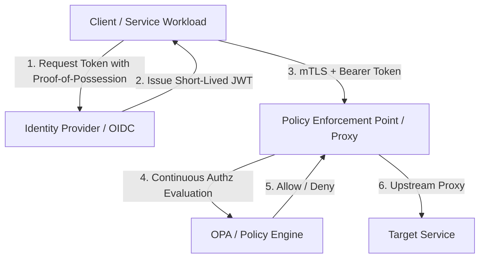

Perimeter-based network defenses were designed for an era when enterprise servers lived inside physical data centers, demarcated by physical firewalls. Today, modern architectures span multi-cloud environments, distributed Kubernetes clusters, SaaS integrations, and edge functions. 

In this landscape, the network perimeter is not merely porous—it is functionally nonexistent. The modern security boundary is **identity**.

## Foundations of Zero-Trust

The zero-trust security paradigm rests upon three non-negotiable tenets:
1. **Verify Explicitly**: Always authenticate and authorize based on all available data points, including user identity, device health, service telemetry, and behavioral context.
2. **Use Least-Privileged Access**: Limit access with Just-In-Time (JIT) and Just-Enough-Access (JEA) models, risk-based adaptive policies, and data protection.
3. **Assume Breach**: Minimize the blast radius by segmenting access by network, user, devices, and application awareness. Encrypt all sessions end-to-end.

### Perimeter vs. Identity-Centric Models

The historical perimeter model assumed that any actor or service operating inside the corporate VPN was trustworthy. When an attacker compromised a single endpoint or an ingress service, lateral traversal was trivial.

Identity-centric zero-trust, by contrast, requires mutual cryptographic verification on every request, regardless of whether the request originates from localhost, a private VPC, or the public internet.



## Implementing Workload Identity Federation

Workload identity federation allows cloud-hosted workloads to authenticate directly against cloud provider APIs without managing or rotating static service account keys.

### Token Exchange Flow

Consider a workload running on Google Kubernetes Engine (GKE) or AWS ECS that needs to access sensitive secrets or database instances:

```go
package main

import (
	"context"
	"fmt"
	"log"
	"time"
)

// TokenValidator evaluates incoming claims against zero-trust policy invariants.
type TokenValidator struct {
	Issuer   string
	Audience string
}

func (tv *TokenValidator) ValidateClaim(tokenSubject string, expiry time.Time) error {
	if time.Now().After(expiry) {
		return fmt.Errorf("token expired at %v", expiry)
	}
	log.Printf("Verified workload identity: %s from issuer: %s", tokenSubject, tv.Issuer)
	return nil
}

func main() {
	validator := &TokenValidator{
		Issuer:   "https://accounts.google.com",
		Audience: "spiffe://prod.internal/secops",
	}
	err := validator.ValidateClaim("svc-billing-worker", time.Now().Add(10*time.Minute))
	if err != nil {
		log.Fatal(err)
	}
}
```

## Continuous Authorization and Telemetry

Zero-trust is not a point-in-time handshake; it is continuous. If a workload's posture degrades or anomalous egress patterns are detected, active sessions must be terminated dynamically using Continuous Access Evaluation (CAEP).

### Observability as a Security Primitive

To enforce adaptive access, telemetry streams must be unified across:
- **Egress & Ingress Proxies**: Envoy access logs detailing TLS cipher suites and mTLS identities.
- **Audit Trails**: CloudTrail, Cloud Audit Logs, and Azure Activity Logs.
- **Runtime Enforcers**: eBPF-based kernel event probes monitoring suspicious syscalls.

## Conclusion

Transitioning to zero-trust is not an off-the-shelf product procurement; it is an architectural discipline. By anchoring all communications in cryptographic identity, deprecating long-lived secrets, and validating every transaction continuously, organizations can build systems that withstand modern attack patterns.
