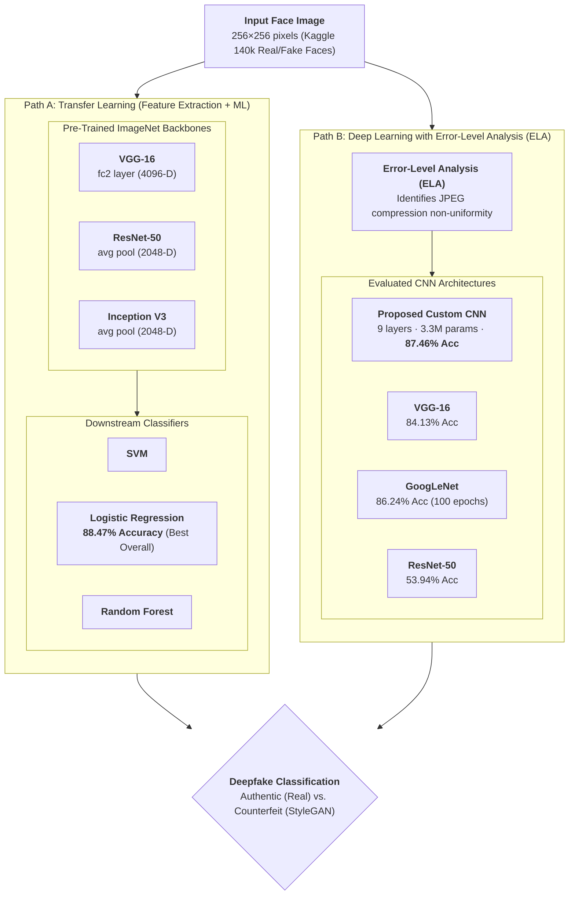

## Overview

Advances in deep generative modeling (such as Generative Adversarial Networks and StyleGAN) have enabled the synthesis of photorealistic counterfeit human faces that are virtually indistinguishable from authentic photographs to the naked human eye. These synthetic media pose significant risks to identity verification systems, public discourse, and social trust.

Presented at the **2021 International Conference on Computing, Communication and Green Engineering (IEEE CCGE)**, this research investigates automated digital forensic methods to detect GAN-generated counterfeit faces. We designed and benchmarked two distinct technical approaches:
1. **Deep Learning with Error-Level Analysis (ELA)**: A custom 9-layer Convolutional Neural Network trained directly on compression-artifact maps.
2. **Transfer Learning Feature Extraction**: Extracting deep spatial representations from pre-trained ImageNet architectures (ResNet-50, VGG-16, Inception V3) and classifying them with classical machine learning models.

The paper has earned **17+ citations** in multimedia forensics and computer vision literature.

---

## Detection Architecture

The complete system pipeline mirrors the two-track methodology evaluated in the paper:



---

## Technical Highlights

### 1. Error-Level Analysis (ELA) Preprocessing
JPEG compression operates across $8 \times 8$ pixel frequency blocks at approximately uniform compression levels across an authentic, unedited photograph (e.g. consistent background and hair compression). Generative networks like StyleGAN generate faces pixel-by-pixel, introducing distinct, high-frequency compression discrepancies:
- **Real Images**: Exhibit high uniformity across the background and hair regions in their ELA difference map.
- **Counterfeit Images**: Display pronounced, non-uniform error levels across facial features (eyes, nose, mouth boundaries).
- The resulting ELA residual map is rescaled to $128 \times 128 \times 3$ and fed into the deep learning models.

### 2. Proposed Custom 9-Layer CNN Architecture
We designed a lightweight CNN tailored specifically for ELA residual maps, containing **3,306,434 trainable parameters**:
- **Input Layer**: $128 \times 128 \times 3$ ELA image tensor.
- **Convolutional Stages**:
  - Conv Layer 1: 32 filters ($5 \times 5$ kernel), followed by $2 \times 2$ Max-Pooling.
  - Conv Layer 2: 64 filters ($3 \times 3$ kernel), followed by $2 \times 2$ Max-Pooling.
  - Conv Layer 3: 128 filters ($3 \times 3$ kernel), followed by $2 \times 2$ Max-Pooling.
- **Dense Head**: Flattened 1D feature array $\to$ Dense layer with 128 units (ReLU activation) $\to$ Output layer with Softmax activation.
- **Performance**: Achieved **87.46% accuracy** and **87.57% F1-score** in just **20 epochs**, outperforming GoogLeNet (which required 100 epochs to reach 86.24%) and VGG-16 (84.13%).

### 3. Transfer Learning & Classifier Benchmarking
In the transfer learning path, we decoupled feature representation from classification:
- **Feature Extraction**: Extracted high-dimensional feature representations from models pre-trained on ImageNet:
  - **VGG-16**: 4,096-dimensional vectors extracted from the `fc2` fully connected layer.
  - **ResNet-50**: 2,048-dimensional vectors extracted from the global `avg pool` layer.
  - **Inception V3**: 2,048-dimensional vectors extracted from the global `avg pool` layer.
- **Downstream Classifiers**: Evaluated Support Vector Machines (SVM), Logistic Regression, and Random Forest.
- **Top Overall Result**: **ResNet-50 + Logistic Regression** yielded the highest performance across the entire study:
  - **Accuracy**: 88.47%
  - **F1-Score**: 88.40%
  - **Precision**: 88.95%
  - **Specificity**: 89.08%
- **Key Insight**: While end-to-end ResNet-50 achieved only 53.94% accuracy when trained directly on ELA images, freezing its convolutional backbone and training a Logistic Regression classifier on its latent features boosted detection accuracy to **88.47%** (+34.5% improvement).

---

## Dataset & Experimental Evaluation

- **Dataset**: Kaggle *"140k Real and Fake Faces"*:
  - **Real Faces**: 70,000 real images from the Flickr-Faces-HQ (FFHQ) dataset collected by Nvidia.
  - **Counterfeit Faces**: 70,000 fake faces generated using StyleGAN (*"1 Million Fake Faces"*).
  - **Resolution**: $256 \times 256$ pixels.
- **Data Splits**:
  - **Training & Validation**: 25,000 images (12,500 real, 12,500 fake, with 5,000 reserved for validation).
  - **Test Set**: 20,000 unseen images (10,000 authentic, 10,000 counterfeit).

### Comparative Results Summary

| Approach | Model / Classifier | Accuracy | F1-Score | Precision | Recall |
| :--- | :--- | :---: | :---: | :---: | :---: |
| **Deep Learning (ELA)** | **Proposed Custom CNN (20 epochs)** | **87.46%** | **87.57%** | **86.76%** | **88.40%** |
| Deep Learning (ELA) | GoogLeNet (100 epochs) | 86.24% | 86.26% | 86.17% | 86.35% |
| Deep Learning (ELA) | VGG-16 (20 epochs) | 84.13% | 85.41% | 79.01% | 92.95% |
| Deep Learning (ELA) | ResNet-50 (20 epochs) | 53.94% | 27.88% | 64.20% | 17.81% |
| **Transfer Learning** | **ResNet-50 + Logistic Regression** | **88.47%** | **88.40%** | **88.95%** | **87.87%** |
| Transfer Learning | ResNet-50 + SVM | 88.41% | 88.34% | 88.90% | 87.79% |
| Transfer Learning | Inception V3 + Logistic Regression | 84.27% | 84.25% | 84.35% | 84.16% |
| Transfer Learning | VGG-16 + Logistic Regression | 79.68% | 79.42% | 80.46% | 78.42% |

---

## Citation

```bibtex
@inproceedings{kumar2021deepfake,
  author={Kumar, Niteesh and P, Pranav and Nirney, Vishal and V, Geetha},
  booktitle={2021 International Conference on Computing, Communication and Green Engineering (CCGE)}, 
  title={Deepfake Image Detection using CNNs and Transfer Learning}, 
  year={2021},
  pages={1--6},
  doi={10.1109/CCGE50943.2021.9776410}
}
```
