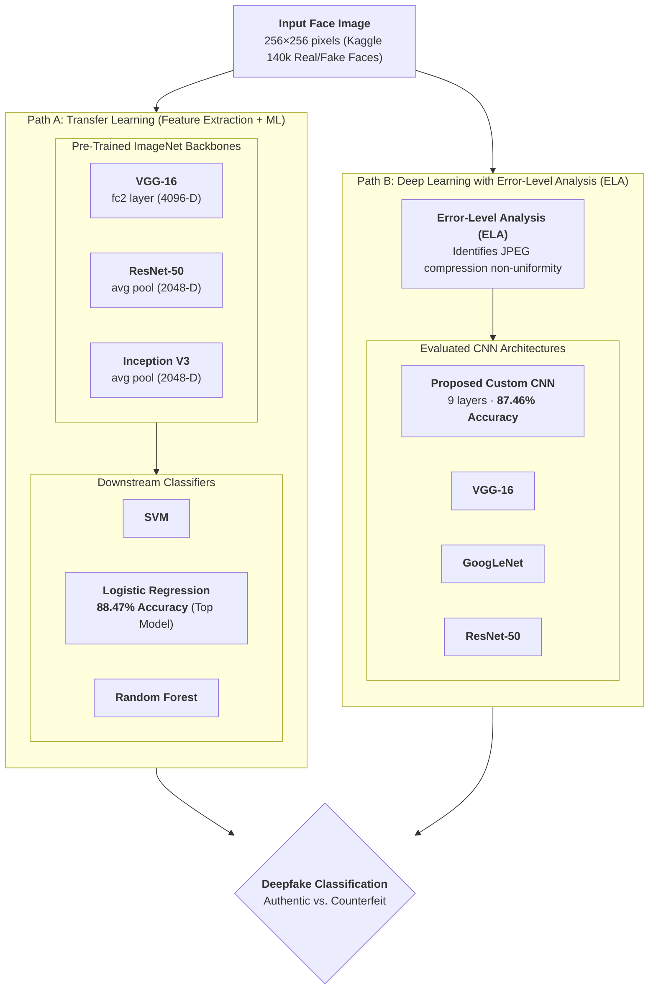

## Overview

Advances in deep generative models like StyleGAN have made photorealistic counterfeit faces virtually indistinguishable from authentic photographs. These synthetic media pose significant security challenges for identity authentication, digital media integrity, and public trust.

Published at the **2021 International Conference on Computing, Communication and Green Engineering (IEEE CCGE)**, this research investigates automated digital forensic methods for detecting GAN-synthesized facial imagery. We benchmarked two distinct technical approaches:
1. **Deep Learning with Error-Level Analysis (ELA)**: A custom 9-layer CNN trained directly on JPEG compression error residuals to detect synthetic artifacts.
2. **Transfer Learning Feature Extraction**: Extracting deep spatial representations from pre-trained backbones (ResNet-50, VGG-16, Inception V3) and classifying them using downstream machine learning models.

The paper has garnered **17+ citations** in multimedia forensics literature.

---

## Detection Architecture



---

## Key Findings

- **Error-Level Analysis Isolates Synthetic Artifacts**: While authentic camera photographs exhibit uniform compression across backgrounds and hair, StyleGAN faces display pronounced compression inconsistencies around eyes, mouth, and facial boundaries.
- **Proposed Custom CNN Outperformed Baselines**: Our lightweight 9-layer CNN trained on ELA maps reached **87.46% accuracy** and **87.57% F1-score** in 20 epochs, outperforming GoogLeNet (which required 100 epochs to reach 86.24%) and VGG-16 (84.13%).
- **Transfer Learning with ResNet-50 + Logistic Regression Won Overall**: Leveraging frozen ResNet-50 representations with a simple Logistic Regression classifier yielded the highest overall score of the study (**88.47% accuracy**, **88.40% F1-score**, **88.95% precision**), proving that combining pre-trained feature extractors with lightweight linear classifiers outperforms end-to-end training for this forensic task.
- **Dataset**: Evaluated on Kaggle's *"140k Real and Fake Faces"* dataset (70,000 Flickr-Faces-HQ authentic portraits and 70,000 StyleGAN synthetic faces).

---

## Citation

```bibtex
@inproceedings{kumar2021deepfake,
  author={Kumar, Niteesh and P, Pranav and Nirney, Vishal and V, Geetha},
  booktitle={2021 International Conference on Computing, Communication and Green Engineering (CCGE)}, 
  title={Deepfake Image Detection using CNNs and Transfer Learning}, 
  year={2021},
  pages={1--6},
  doi={10.1109/CCGE50943.2021.9776410}
}
```
