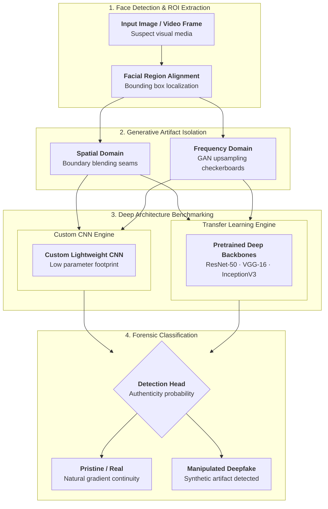

## Overview

The rapid proliferation of deep generative models (GANs, autoencoders) has made realistic facial manipulation—commonly known as *deepfakes*—accessible and convincing. These synthetic media pose significant risks to identity authentication, biometrics, and public trust.

Presented at the **2021 International Conference on Computing, Communication and Green Engineering (CCGE)**, this research explores digital forensic techniques for detecting synthetic face modifications. We conducted a systematic empirical study benchmarking custom-designed Convolutional Neural Network (CNN) architectures against fine-tuned deep transfer-learning backbones.

The paper has received **17 citations** in multimedia forensics research.

---

## Detection Pipeline



## Technical Highlights

### 1. Forensics of Generative Artifacts
Deepfake synthesis pipelines frequently introduce subtle spatial and frequency-domain inconsistencies that human observers miss but neural feature extractors can isolate:
- Boundary blending seams around facial perimeters and jawlines.
- Checkerboard artifacting caused by transposed convolution and upsampling layers in GAN generators.
- Texture discrepancies across skin tone gradients, eye reflections, and teeth boundaries.

### 2. Architecture Benchmarking
We evaluated multiple detection topologies:
- **Custom Shallow/Medium CNNs**: Designed for lightweight inference and low parameter footprints, testing how effectively minimal receptive fields capture high-frequency facial noise.
- **Transfer Learning Backbones**: Pre-trained convolutional networks (ResNet, VGG, Inception) fine-tuned on benchmark manipulation datasets (such as FaceForensics++ and Celeb-DF), evaluating feature reuse and representation generalization.

### 3. Latency vs. Accuracy Trade-Offs
In high-throughput screening environments (e.g., identity verification or platform upload filters), deep ensembles are computationally prohibitive. We analyzed precision-recall curves alongside wall-clock inference latency per frame to identify architectures that maintain high true-positive detection rates while remaining computationally viable.

---

## Citation

```bibtex
@inproceedings{kumar2021deepfake,
  author={Kumar, Niteesh and P, Pranav and Nirney, Vishal and V, Geetha},
  booktitle={2021 International Conference on Computing, Communication and Green Engineering (CCGE)}, 
  title={Deepfake Image Detection using CNNs and Transfer Learning}, 
  year={2021},
  pages={1--6},
  doi={10.1109/CCGE50943.2021.9776410}
}
```
