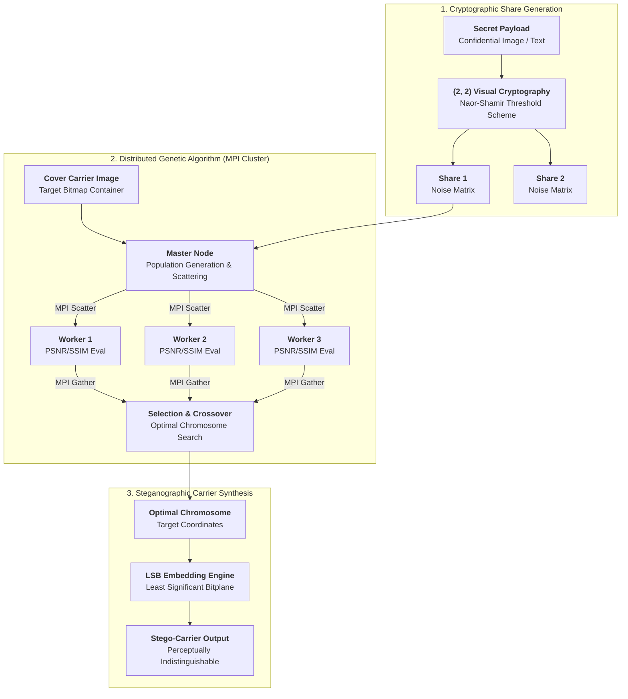

## Overview

Steganography hides confidential payloads inside innocuous cover carriers such that third-party observers cannot detect the transmission. However, achieving high embedding capacity while preserving visual imperceptibility and cryptographic strength requires computationally demanding optimization.

Published in **Advances in Intelligent Systems and Computing (Springer ICIoTCT 2021)**, this project proposes a high-security steganographic pipeline combining **(2, 2) Visual Cryptography**, **Least Significant Bit (LSB) embedding**, and **Genetic Algorithm (GA) optimization**, distributed across an MPI cluster to eliminate performance bottlenecks.

---

## Architecture & Pipeline



### 1. Visual Cryptography Splitting
The secret payload is divided into two distinct random shares ($S_1, S_2$) using a Naor-Shamir threshold scheme. Neither share conveys information individually; only their superimposition or cryptographic recombination reconstructs the original payload.

### 2. Genetic Algorithm Optimization
Embedding secret bits into arbitrary cover locations alters statistical pixel distributions and exposes the message to chi-square and steganalysis attacks. We used a Genetic Algorithm to discover optimal embedding positions:
- **Chromosomes**: Encode candidate sequences of pixel coordinates within the cover carrier.
- **Fitness Function**: Maximizes Peak Signal-to-Noise Ratio (PSNR) and Structural Similarity Index (SSIM) while minimizing Mean Squared Error (MSE), ensuring the carrier remains visually and statistically indistinguishable from the pristine original.

### 3. Distributed Cluster Computing with MPI
Evaluating genetic fitness over high-resolution cover images across dozens of generations is compute-bound. Using `mpi4py`, NFS shared storage, and SSH cluster interconnects:
- The master node distributes candidate sub-populations across worker nodes.
- Workers compute image slicing, fitness evaluations, and LSB projections concurrently.
- Results are gathered at each generation boundary for selection and crossover, achieving near-linear speedup as worker nodes scale.

---

## Citation

```bibtex
@incollection{maru2021distributed,
  author={Maru, Harsh and Pranav, P. and Miryala, Yashwanth and Rudra, Bhawana},
  title={Distributed Computing Solution for Steganography Using Visual Cryptography and Genetic Algorithm},
  booktitle={Internet of Things and Connected Technologies},
  series={Advances in Intelligent Systems and Computing},
  volume={1382},
  pages={201--211},
  year={2021},
  publisher={Springer},
  doi={10.1007/978-3-030-76736-5_21}
}
```
