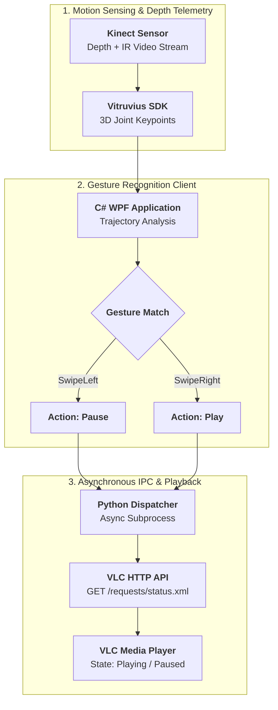

## Overview

Touchless Human-Computer Interaction (HCI) enables users to manipulate digital media in sterile environments (e.g., surgical suites, culinary spaces) or living-room entertainment contexts without touching mice, keyboards, or physical remote controls.

Developed as part of human-computer interface coursework, this system interfaces a **Microsoft Kinect for Xbox One** with desktop media players (VLC), translating upper-body skeletal gestures in 3D camera space into real-time playback actions.

---

## Technical Pipeline

### 1. Skeletal Tracking via Vitruvius
The C# WPF client integrates the **LightBuzz Vitruvius** framework to track body joint coordinates in real-time camera space:
- Extracts positions and trajectories for shoulders, elbows, wrists, and hand tips.
- Evaluates kinematic displacement velocity vectors to isolate intentional swipe motions from natural conversational hand fidgeting.

### 2. Gesture Mapping
- **`SwipeLeft`**: Dispatches pause command when the user sweeps an open hand laterally across the torso plane.
- **`SwipeRight`**: Dispatches play / resume command.

### 3. Asynchronous IPC & HTTP Control
Rather than embedding heavy network libraries inside the WPF rendering loop:
- The GUI application asynchronously invokes a lightweight Python bridge passing the detected gesture token.
- The Python script dispatches authenticated HTTP GET requests to VLC's embedded web interface (`http://localhost:8080/requests/status.xml?command=pl_pause`), decoupling motion tracking from network transport latency.
