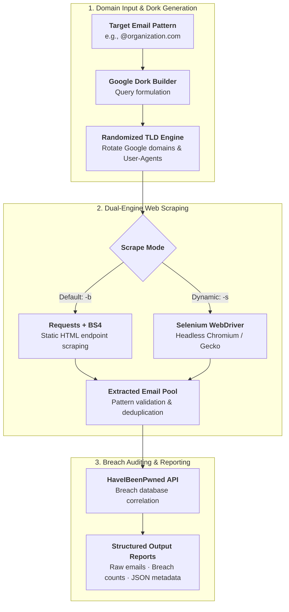

## Overview

During the passive reconnaissance phase of a penetration test or security audit, mapping an organization's exposed email addresses and credential leak history is critical for assessing phishing vulnerability and credential stuffing risk.

**Mail Recon** is a Python OSINT utility that automates email address discovery across the public web for target domain patterns (e.g., `@organization.com`) and queries data breach repositories to quantify an organization's compromised account exposure.

---

## OSINT Pipeline

## Technical Highlights

### 1. Search Engine Dorking & Anti-Bot Evasion
- Automated search engine scraping frequently triggers CAPTCHAs and IP rate limits.
- Mail Recon implements dynamic **TLD rotation**: on each query execution, it targets randomized Google top-level domain extensions (`google.co.uk`, `google.co.in`, `google.ca`, etc.) alongside randomized user agents to distribute query footprints and evade automated blocking.

### 2. Dual-Engine Web Scraping
- **Basic Scraper**: High-speed, lightweight HTTP request parser for static HTML endpoints using `requests` and `BeautifulSoup`.
- **Selenium Headless Engine**: Automates headless Chromium/Gecko drivers via Selenium (`-s` flag) to evaluate dynamic JavaScript frameworks and client-rendered single-page applications where raw HTTP requests fail to render DOM content.

### 3. Breach Intelligence Correlation
- Harvested addresses are validated and cross-referenced against the **HaveIBeenPwned (HIBP)** breach intelligence API.
- Generates structured reporting across multiple outputs:
  - Verified discovered email addresses.
  - Frequency count of breach incidents per email.
  - Source URL mapping where each address was uncovered.
  - Full JSON payload dump of associated breach metadata (breach dates, leaked data classes: plaintext passwords, password hashes, PII) for security analyst reporting.
