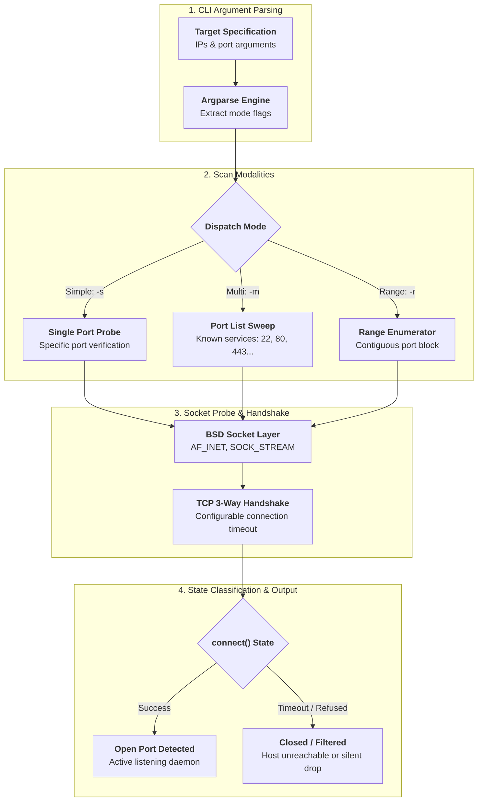

## Overview

Network exploration tools like Nmap are powerful, but enterprise and air-gapped environments often restrict external tool installations or third-party binary downloads. Having a native, zero-dependency network discovery script is vital for rapid host diagnostics and baseline security auditing.

**Port Mapper** (`P0rt M4pp3r`) is a lightweight CLI port-scanning tool implemented purely in standard library Python using low-level BSD socket programming.

---

## Scanning Architecture

## Capabilities & Implementation

### 1. Zero-Dependency Socket Architecture
Built exclusively with Python's native `socket` and `argparse` modules, allowing immediate execution on any machine with Python 3 without virtualenv setup or package manager dependencies.

### 2. Flexible Scanning Modes
The utility supports three distinct operational use cases:
- **Simple Single-Port Probing (`-s port ip`)**: Rapid check to verify if a specific daemon or service port (e.g., SSH on port 22) is open and accepting TCP handshakes.
- **Multi-Port Service Sweeps (`-m port1,port2,... ip`)**: Targeted enumeration across known high-value service ports (e.g., `22,80,443,3306,5432,6379,8080`) on an individual target.
- **Port Range Sweeps (`-r start-port end-port ip1,ip2,...`)**: Exhaustive scanning across a contiguous port range (e.g., `1000-5000`) spanning one or multiple target IP addresses.

### 3. Connection State Handling
Implements standard non-blocking/timed TCP three-way handshake probes (`SOCK_STREAM`), capturing `connect()` outcomes to differentiate actively listening ports from filtered drops and closed sockets with clean console reporting.
