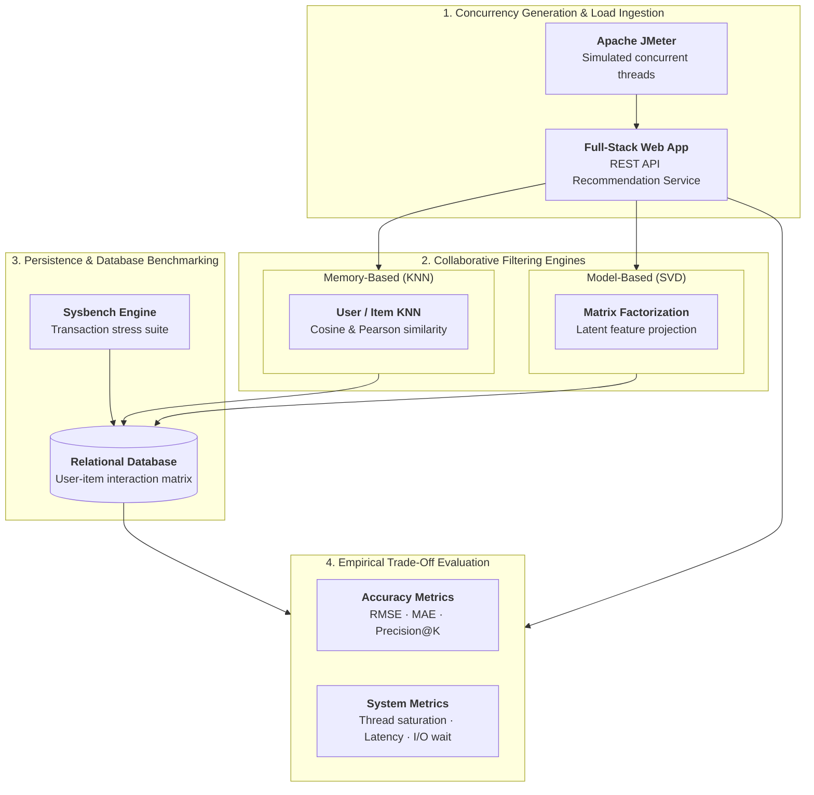

## Overview

Recommender systems are essential components of modern web applications, driving user discovery and platform engagement. While research literature predominantly focuses on mathematical accuracy metrics (such as RMSE or precision@k), real-world production deployments depend equally on system-level latency, database contention, and throughput under concurrent user loads.

Presented at the **2022 6th International Conference on Trends in Electronics and Informatics (IEEE ICOEI)**, this paper conducts a comparative performance evaluation of collaborative filtering models embedded within full-stack web applications, measuring algorithmic accuracy alongside system scalability under stress testing.

---

## System Architecture & Benchmarking



## Technical Highlights

### 1. Collaborative Filtering Architectures
We implemented and compared core recommendation paradigms:
- **Memory-Based Approaches**: User-based Collaborative Filtering (UBCF) and Item-based Collaborative Filtering (IBCF) using K-Nearest Neighbors (KNN) with cosine similarity and Pearson correlation metrics.
- **Model-Based Approaches**: Matrix Factorization utilizing Singular Value Decomposition (SVD) to project high-dimensional, sparse user-item interaction matrices into low-rank latent feature representations.

### 2. Full-Stack Web Integration
To simulate realistic deployment conditions rather than isolated offline model tests:
- Recommendation pipelines were integrated into a web service backed by a relational database tier.
- Addressed cold-start challenges, cache invalidation, and real-time inference latency for active sessions.

### 3. Concurrency & Database Benchmarking
We performed rigorous load testing using **Apache JMeter** and **Sysbench**:
- Simulated hundreds of concurrent user requests querying recommendations simultaneously.
- Measured server CPU utilization, memory footprints, thread pool saturation, database connection pooling behavior, and I/O wait times.
- Analyzed the trade-off frontier between model accuracy and server throughput to determine optimal caching and pre-computation strategies for production scale.

---

## Citation

```bibtex
@inproceedings{bhat2022comparative,
  author={Bhat, Swathi S and P, Pranav and K V, Shashank and Raghunandan, Arpitha and Mohan, Biju R},
  booktitle={2022 6th International Conference on Trends in Electronics and Informatics (ICOEI)}, 
  title={Comparative Performance Evaluation of Web-Based Book Recommender Systems}, 
  year={2022},
  pages={568--574},
  doi={10.1109/ICOEI53556.2022.9777116}
}
```
