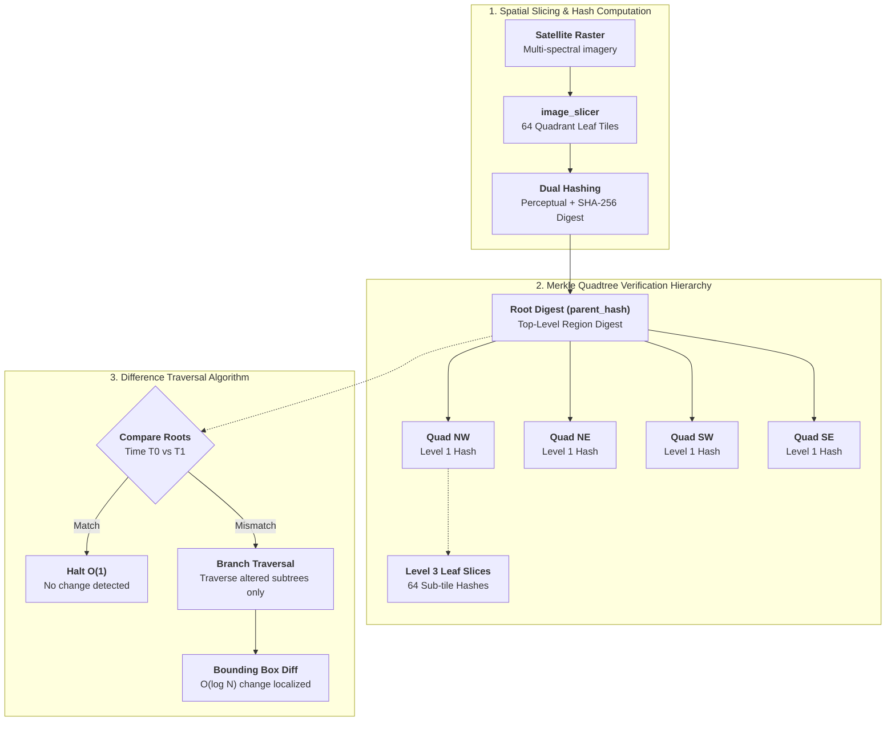

## Overview

High-resolution satellite and aerial imagery datasets are enormous, frequently spanning gigabytes to terabytes per capture. When monitoring environmental change—such as deforestation, wildfire damage, flood expansion, or urban development—comparing entire multi-gigapixel rasters pixel-by-pixel across time intervals is computationally wasteful because the overwhelming majority of the terrain remains unchanged.

This project implements a spatial indexing and change-detection pipeline using a **Merkle Quadtree** (`merkleQuadTree`), marrying hierarchical 2D spatial decomposition with cryptographic hash trees to perform $O(\log N)$ difference localization.

---

## Technical Architecture

### 1. Quadtree Recursive Slicing
- Uses `image_slicer` to recursively subdivide high-resolution satellite imagery into quadrants across hierarchical depth levels (down to Level 3, producing 64 fine-grained geographic tiles).
- Each bounding box quadrant represents a spatially localized coordinate region on the Earth's surface.

### 2. Multi-Level Merkle Hashing
- Computes cryptographic digests (SHA-256) and perceptual hashes (`imagehash`) for each leaf tile. Perceptual hashing accounts for minor sensor noise and lighting variations, while cryptographic hashing guarantees strict bitwise integrity.
- Intermediate nodes concatenate and hash child digests upwards through `hash_level3`, `hash_level2`, `hash_level1`, culminating in a single top-level `parent_hash` (the Merkle root).

### 3. Logarithmic Difference Traversal
- When comparing two temporal snapshots of the same geographic region (Time $T_0$ vs Time $T_1$):
  1. Compare the root `parent_hash`. If identical, zero change has occurred across the entire multi-gigabyte area; comparison halts in $O(1)$ time.
  2. If mismatched, the algorithm descends only down the child branches whose hashes diverge, pruning the traversal tree for unchanged quadrants.
  3. Change bounding boxes are extracted directly at the leaf level, pinpointing modified ground regions without reprocessing millions of static pixels.
