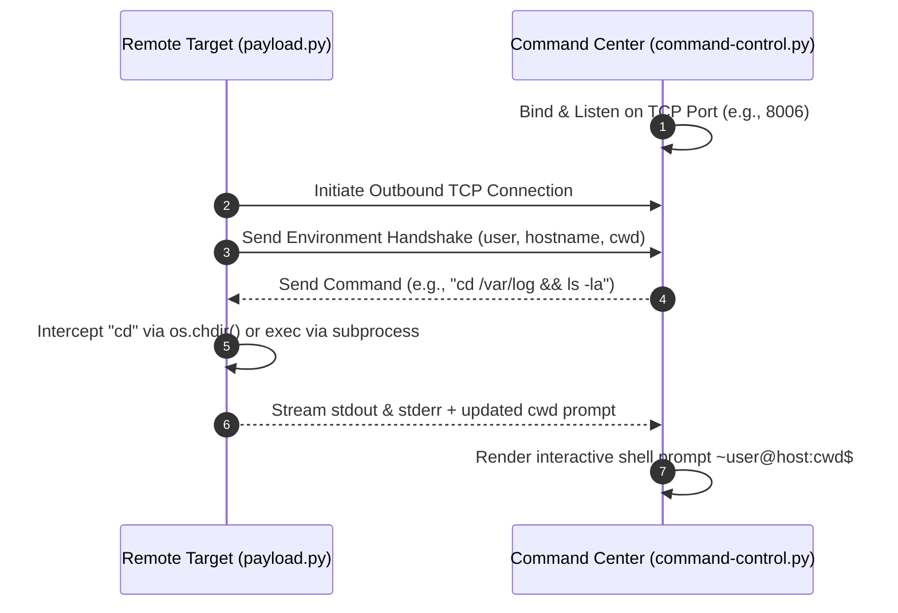

## Overview

Traditional basic reverse shells (such as `/bin/sh` piped through netcat) suffer from severe operational limitations: stateful commands like `cd` fail to persist working directory context across execution lines, interactive program prompts freeze the connection, and stderr output is frequently lost or silently discarded.

This project implements a custom two-stage Python Command-and-Control (C2) framework consisting of a listener Command Center (`command-control.py`) and a remote agent Payload (`payload.py`) communicating over a raw TCP socket. The framework is engineered to provide a responsive, pseudo-terminal experience for security research and controlled penetration testing labs.

---

## Architecture & Design

### 1. Stateful Working Directory Tracking
In naive reverse shells, each command runs in an isolated subprocess fork; executing `cd /tmp` changes the directory of the ephemeral child process and exits, leaving subsequent commands running in the original launch directory. The payload intercepts directory-changing primitives, modifies the parent process execution state via `os.chdir()`, and synchronizes the active working directory back to the C2 operator.

### 2. Dual-Channel Standard I/O Redirection
The payload captures both standard output (`stdout`) and standard error (`stderr`) pipes from `subprocess.Popen`, multiplexing them into the TCP socket stream so syntax errors, permission denials, and command output are accurately reflected back to the controller.

### 3. Interactive Terminal Emulation
The C2 controller dynamic prompt mirrors native Bash/Zsh syntax (`~username@hostname:working_directory$`), creating an intuitive CLI interface without requiring manual terminal line discipline workarounds (such as `python -c 'import pty; pty.spawn("/bin/bash")'`).
