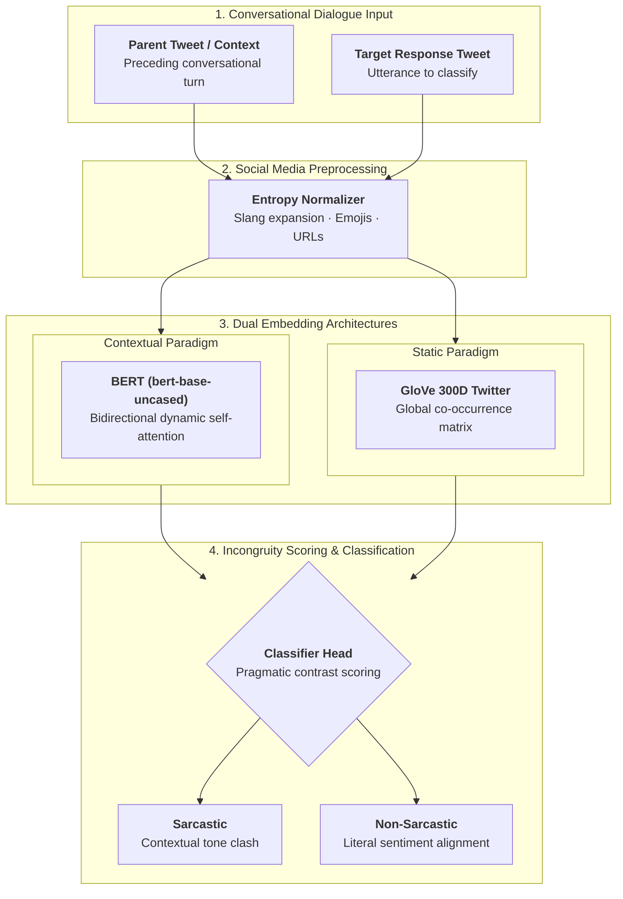

## Overview

Sarcasm is an inherently nuanced form of communication where the literal meaning of an utterance directly contradicts the intended pragmatic message. In short, noisy social media texts such as Twitter, sarcasm detection becomes especially challenging due to character limits, slang, emojis, and incomplete context.

Published in the **Proceedings of the Second Workshop on Figurative Language Processing (ACL 2020)**, this research investigates automated sarcasm detection by benchmarking contextual transformer embeddings (**BERT**) against dense non-contextual word vectors (**GloVe**), while explicitly modeling the conversational dialogue thread preceding the response.

The paper has garnered **56+ citations** across computational linguistics and affective computing literature.

---

## Technical Pipeline



## Technical Highlights

### 1. Conversational Context Modeling
Traditional sentiment classifiers evaluate individual tweets in isolation. However, sarcasm is frequently unintelligible without understanding what the speaker is reacting to. Our pipeline:
- Ingests the target response tweet paired with its parent conversational context.
- Encodes both dialogue turns to detect incongruity, pragmatic contrast, and tone divergence between the original statement and the reply.

### 2. Embedding Architecture Comparison
We compared two embedding paradigms:
- **BERT (`bert-base-uncased`)**: Bidirectional self-attention layers capture token representations dynamically based on surrounding syntactic and semantic context.
- **GloVe (300-dimensional Twitter vectors)**: Pre-trained static global co-occurrence vectors feeding downstream recurrent and dense classification heads.

### 3. Noise Normalization & Social Media Preprocessing
Twitter text contains high entropy. The preprocessing pipeline implemented:
- URL, hashtag, and user-mention tokenization (`@USER`, `HTTPURL`).
- Emoji translation and sentiment preservation.
- Contraction expansion and character repetition normalization (e.g., *"suuuper"* $\to$ *"super"*).

---

## Citation

```bibtex
@inproceedings{khatri-p-2020-sarcasm,
    title = "Sarcasm Detection in Tweets with {BERT} and {G}lo{V}e Embeddings",
    author = "Khatri, Akshay and P, Pranav",
    booktitle = "Proceedings of the Second Workshop on Figurative Language Processing",
    month = jul,
    year = "2020",
    address = "Online",
    publisher = "Association for Computational Linguistics",
    url = "https://aclanthology.org/2020.figlang-1.7/",
    doi = "10.18653/v1/2020.figlang-1.7",
    pages = "56--60"
}
```
