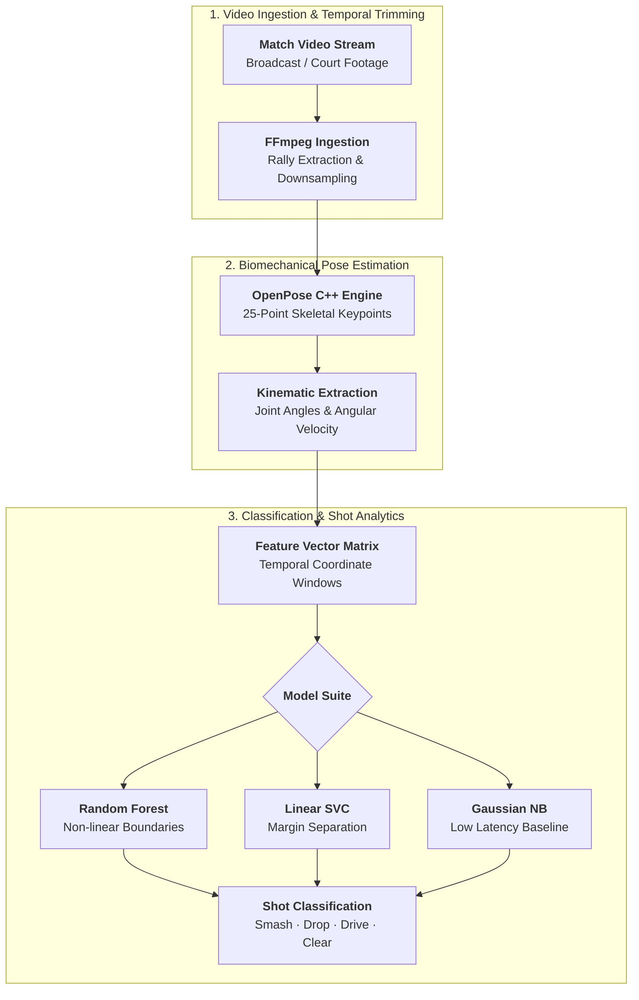

## Overview

In professional racquet sports such as badminton, elite coaching and tactical analysis rely on detailed breakdowns of player movement, court positioning, and shot execution. Traditionally, this data requires hours of manual match video tagging.

This project implements an end-to-end computer vision and machine learning pipeline that automatically ingests match footage, extracts player skeletal biomechanics in real time, and classifies technical shot varieties (e.g., *smashes*, *drops*, *drives*, *clears*) using trained classifiers.

---

## Technical Pipeline

### 1. Pose Estimation & Skeletal Tracking
- Used the **OpenPose** C++ engine (`openpose.bin`) with `--disable_blending=True` and `--write_keypoint` to extract 25-point 2D body joints (wrists, elbows, shoulders, hips, knees, ankles, neck) per frame.
- Processed high-resolution match footage through automated FFmpeg temporal trimming and frame downsampling pipelines to reduce inference latency.

### 2. Biomechanical Feature Engineering
Raw pixel coordinates vary drastically depending on camera angle, player distance, and court positioning. The feature extraction engine normalized data by:
- Centering coordinate systems relative to the torso/hip joint.
- Computing joint angles (elbow flexion, shoulder abduction, knee bend) across consecutive frame windows during swing preparation and contact.
- Calculating angular velocities and racquet acceleration vectors to differentiate aggressive downward attacks (smashes) from deceptive touch shots (drops).

### 3. Classification Models & Evaluation
Trained and benchmarked multiple machine learning classification models on curated stroke datasets:
- **Random Forest (`rf_model.sav`)**: Provided robust feature importance rankings and non-linear boundary separation.
- **Linear SVC (`lsvc_model.sav`)**: Effective high-dimensional margin separation with rapid evaluation times.
- **Gaussian Naive Bayes (`gnb_model.sav`)**: Ultra-lightweight baseline for streaming frame classification.
- **Logistic Regression (`lr_model.sav`)**: Calibrated probability distributions across shot types.

---

## Applications & Insights
The automated pipeline enables post-match heatmaps, tactical shot-selection distributions against specific opponents, and automated rally segmentation without manual annotation overhead.
