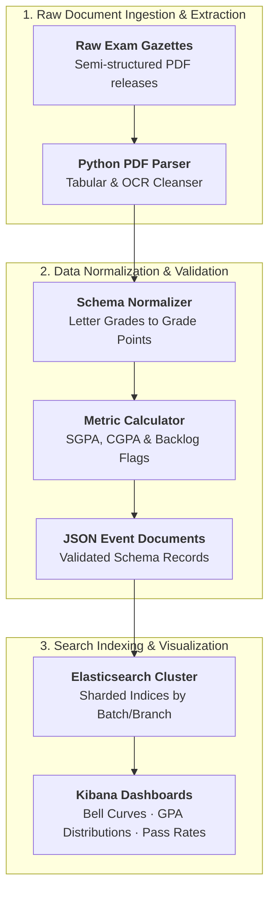

## Overview

University semester examination results are often released as large, semi-structured PDF gazettes containing thousands of student roll numbers, course codes, internal evaluation marks, and semester grade point averages (SGPA/CGPA). Analyzing institutional performance trends—such as grade deflation in specific courses, departmental pass percentages, or prerequisite correlation—historically required painstaking manual spreadsheet manipulation.

This project engineered a "zero-touch" automated ETL pipeline that ingests raw examination PDF releases, cleanses and normalizes student performance records, indexes the data into an **Elasticsearch** cluster, and generates interactive **Kibana** dashboards for academic analytics.

---

## Architecture & Data Flow

### 1. Ingestion & Tabular PDF Extraction
- Built custom Python extraction routines to parse dense, multi-column PDF layouts where table borders and whitespace alignments frequently drift across pages.
- Handled edge cases including absent candidates, withheld results, grade revisions, and multi-line course descriptors.

### 2. Normalization & Schema Validation
- Converted letter grades (`S`, `A`, `B`, `C`, `D`, `E`, `F`) into normalized numerical grade points aligned with university grading scales.
- Calculated cumulative GPA trajectories, flagged backlog status, and enriched student records with departmental and cohort metadata.

### 3. Aggregations & Analytics Dashboards
Indexed records into Elasticsearch to enable instantaneous querying and aggregated statistical reporting via Kibana:
- **Grade Distribution Curves**: Visualizing bell curves across individual core courses to detect grading anomalies or unusually high failure rates.
- **Departmental Benchmarking**: Comparing performance metrics across academic disciplines and graduating cohorts.
- **Correlation Insights**: Identifying gateway courses where lower foundational grades correlated strongly with downstream semester attrition.
